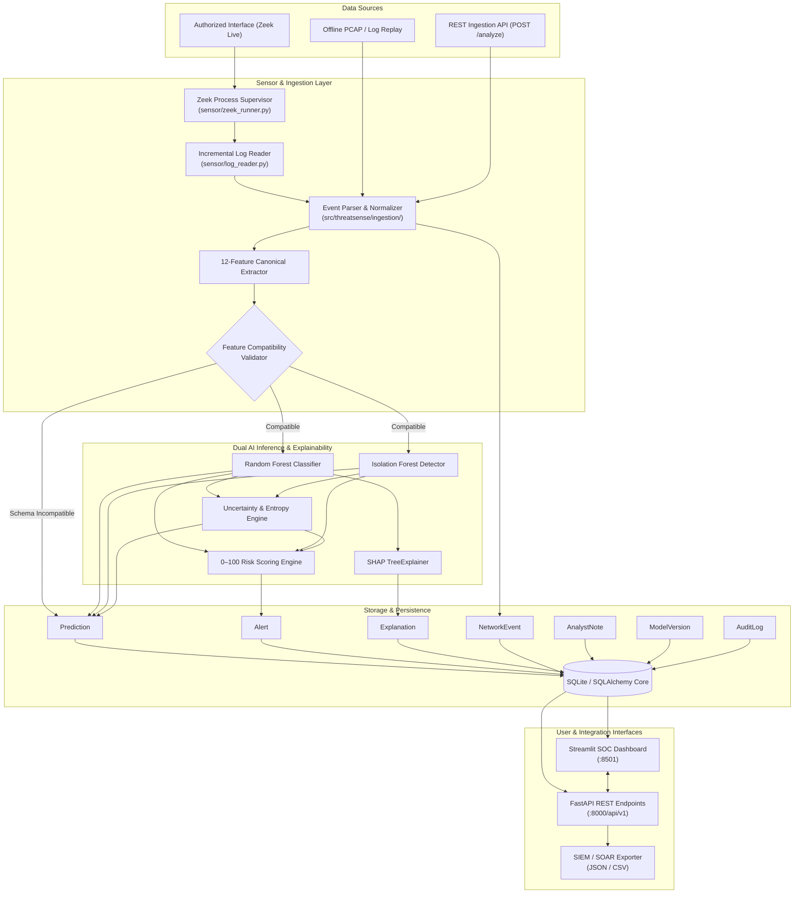

# ThreatSense AI

> **Intelligent Network Threat Detection with Explainable AI and Uncertainty Awareness**  
> *Tagline: Detect. Explain. Defend.*

[](https://www.python.org/)
[](https://fastapi.tiangolo.com/)
[](https://streamlit.io/)
[](https://scikit-learn.org/)
[](https://github.com/slundberg/shap)
[](https://pytest.org/)
[](LICENSE)

---

## 1. Project Overview & Problem Statement

Modern Security Operations Centers (SOCs) face an overwhelming volume of network alerts generated by legacy signature-based intrusion detection systems (IDS). When machine learning models are deployed to assist analysts, they often introduce severe operational bottlenecks:
- **Black-Box Opacity:** Statistical neural networks and tree ensembles flag malicious traffic without explaining *why* a flow was classified as an attack, impeding rapid incident triage.
- **Uncalibrated Confidence & Alert Fatigue:** Standard classifiers output overconfident probabilities on unfamiliar traffic, triggering false positives on harmless protocol anomalies.
- **Out-of-Distribution Vulnerabilities:** Zero-day attack techniques or unusual network configurations fool supervised classifiers trained solely on historical attack patterns.
- **Feature Incompatibility:** Live packet captures or sensor connection logs (such as Zeek `conn.log`) do not natively match the feature schemas of academic datasets (such as CIC-IDS2017), leading practitioners to fabricate missing fields with arbitrary constants.

**ThreatSense AI** solves these challenges by combining:
1. **Passive flow surveillance** on authorized interfaces using Zeek structured connection logs and offline replay.
2. A **strict 12-feature canonical compatibility layer** that maps sensor events to training schemas without silent field fabrication.
3. A **dual-engine AI architecture**: supervised Random Forest multi-class attack detection coupled with unsupervised Isolation Forest anomaly scoring.
4. **Explainable AI (XAI)** using local SHAP TreeExplainer attributions that translate feature weights into natural-language analyst narratives.
5. **Distribution-aware uncertainty scoring** that evaluates Shannon entropy, out-of-distribution (OOD) unfamiliarity, and detector disagreement.
6. A **transparent 0–100 operational risk scoring policy** clearly separated from prediction probabilities.
7. A **cybersecurity operations dashboard** and **FastAPI REST backend** for end-to-end investigation, alert lifecycle management, and SIEM export.

> **Defensive Security Notice:** ThreatSense AI is engineered exclusively for authorized network surveillance, telemetry analysis, and security research. The system never executes intrusive packet injection, denial-of-service, scanning, or destructive countermeasures.

---

## 2. Key Features

- **Dual AI Detection:**
  - **Supervised Classifier:** Multi-class Random Forest categorizing flows into `BENIGN`, `DoS/DDoS`, `PortScan`, `BruteForce`, and `Botnet`.
  - **Unsupervised Anomaly Detector:** Isolation Forest estimating statistical abnormality against baseline normality.
- **Explainable AI (SHAP TreeExplainer):**
  - Per-event directional feature attributions showing which flow metrics drove the classification.
  - Plain-language SecOps narratives distinguishing statistical model evidence from verified security facts.
  - Automatic fallback to surrogate feature weights if tree conditions are restricted.
- **Uncertainty & Out-of-Distribution (OOD) Engine:**
  - Computes normalized Shannon entropy across class probabilities.
  - Flags **detector disagreement** (e.g. classifier predicts benign while anomaly detector flags high abnormality).
  - Identifies unfamiliar traffic as out-of-distribution and raises a `review_required` diagnostic flag.
- **Transparent Operational Risk Scoring:**
  - 0–100 risk score kept strictly separate from raw prediction confidence.
  - Prioritized operational triage bands: **Low** (0–24), **Moderate** (25–49), **High** (50–74), and **Critical** (75–100).
- **Passive Sensor & Offline Replay:**
  - Native integration with Zeek `conn.log` with rotation-aware incremental log tailing.
  - Deterministic offline replay engine for demonstrations without requiring elevated network privileges.
  - Safe subprocess execution with zero command-injection vectors (no `shell=True`).
- **Interactive SOC Dashboard & REST API:**
  - 5-page dark-themed Streamlit operations dashboard with interactive Plotly visual analytics.
  - Complete REST API with OpenAPI documentation, Pydantic v2 validation, database persistence, and SIEM export.

---

## 3. System Architecture & Data Flow



---

## 4. Technology Stack

| Domain | Technologies & Libraries | Version / Requirement |
|---|---|---|
| **Language & Runtime** | Python | 3.11+ (Verified on Python 3.13.7) |
| **REST API Framework** | FastAPI, Starlette, Pydantic v2 | FastAPI 0.143.0, Pydantic 2.14.0 |
| **ASGI Web Server** | Uvicorn (standard) | Uvicorn 0.54.0 |
| **SOC Operations Dashboard** | Streamlit, Plotly Express | Streamlit 1.65.0, Plotly 7.1.0 |
| **Machine Learning Core** | Scikit-learn, NumPy, Pandas, Joblib | scikit-learn 1.9.1, pandas 3.0.6, numpy 2.5.4 |
| **Explainable AI (XAI)** | SHAP (SHapley Additive exPlanations) | shap 0.53.0 |
| **Persistence & Database** | SQLAlchemy Core & ORM, SQLite | SQLAlchemy 2.1.4 |
| **Network Telemetry** | Zeek connection logs (`conn.log`), JSON | Zeek 5.0+ (native Linux / WSL2) |
| **Testing & Quality** | pytest, HTTPX TestClient | pytest 9.1.1, httpx 0.28.1 |
| **Containerization** | Docker, Docker Compose | Multi-container setup |

---

## 5. Repository Directory Structure

```text
ThreatSense-AI/
├── README.md                                 # Master documentation, architecture, and guides
├── LICENSE                                   # MIT open-source license
├── CONTRIBUTING.md                           # Contributor guidelines and workflow
├── SECURITY.md                               # Security policy and vulnerability disclosure
├── pyproject.toml                            # Project metadata and package definition
├── requirements.txt                          # Pinned reproducible dependencies
├── .env.example                              # Safe environment variable template
├── .gitignore                                # Excludes credentials, databases, models, and logs
├── Dockerfile                                # Multi-stage application container
├── docker-compose.yml                        # Orchestration for FastAPI + Streamlit
├── configs/
│   ├── default.yaml                          # Core application settings and risk weights
│   ├── sensor.yaml                           # Zeek interface and replay paths
│   └── logging.yaml                          # Structured logging configuration
├── data/
│   ├── raw/                                  # Destination for raw PCAPs / CIC-IDS2017 CSVs (.gitkeep)
│   ├── processed/                            # Generated train/test feature CSVs (.gitkeep)
│   └── samples/
│       └── sample_zeek_conn.log              # Sanitized demonstration replay records
├── artifacts/
│   ├── models/                               # Model binaries & schema metadata
│   │   ├── metadata.json                     # Model versions, hyperparams, feature contract
│   │   └── .gitkeep                          # Model binaries generated on-demand
│   └── reports/
│       ├── evaluation_report.json            # Model benchmark results & confusion matrix
│       └── performance_benchmarks.json       # Measured latency and throughput metrics
├── sensor/
│   ├── zeek_runner.py                        # Zeek process supervisor (safe tokenized execution)
│   ├── log_reader.py                         # Non-blocking incremental log tailer
│   ├── health.py                             # Sensor health and state tracker
│   └── __init__.py
├── src/
│   └── threatsense/
│       ├── __init__.py
│       ├── config.py                         # Dynamic configuration loader with env overrides
│       ├── logging.py                        # Structured logging utility
│       ├── ingestion/
│       │   ├── schemas.py                    # Raw and Ingested event models
│       │   ├── normalizer.py                 # Timestamp parsing & SHA-256 fingerprinting
│       │   ├── parser.py                     # Zeek JSON & TSV record parser
│       │   └── replay.py                     # Deterministic offline replay engine
│       ├── features/
│       │   ├── schema.py                     # 12-feature canonical contract specification
│       │   ├── extractor.py                  # Flow rate and ratio extraction
│       │   └── compatibility.py              # Schema validator & FEATURE_SCHEMA_INCOMPATIBLE flag
│       ├── detection/
│       │   ├── classifier.py                 # Supervised inference with probability & entropy
│       │   ├── anomaly.py                    # Isolation Forest anomaly scoring
│       │   └── engine.py                     # Master detection pipeline coordinator
│       ├── explainability/
│       │   ├── explainer.py                  # SHAP TreeExplainer with robust fallbacks
│       │   └── formatter.py                  # Plain-language narrative formatter & disclaimers
│       ├── alerting/
│       │   ├── uncertainty.py                # Entropy, OOD unfamiliarity & disagreement detector
│       │   ├── risk.py                       # 0–100 composite risk scoring engine
│       │   └── rules.py                      # Port risk weights & attack severities
│       ├── storage/
│       │   ├── database.py                   # SQLAlchemy sessionmaker & engine
│       │   ├── models.py                     # 7 core database entities
│       │   └── repository.py                 # Paginated events, alerts, and metrics queries
│       └── api/
│           ├── main.py                       # FastAPI application entrypoint with CORS
│           ├── schemas.py                    # Request and response models
│           ├── dependencies.py               # DB sessions & secure API key verification
│           └── routes/                       # Health, Sensor, Events, Alerts, Models, Metrics, Export
├── dashboard/
│   ├── app.py                                # Main navigation & Security Overview page
│   ├── pages/
│   │   ├── 1_Security_Overview.py            # Overview telemetry and priority charts
│   │   ├── 2_Live_Network_Monitor.py         # Real-time event monitor with search & filters
│   │   ├── 3_Alert_Investigation.py          # Forensic inspection, SHAP charts, & triage form
│   │   ├── 4_Model_Performance.py            # Confusion matrix, F1-scores, & model benchmarks
│   │   └── 5_System_Health_and_Settings.py   # Diagnostics, feature dictionary, & risk policies
│   └── components/
│       ├── styles.py                         # Dark navy cyber theme & priority badges
│       ├── charts.py                         # Styled Plotly charts (heatmaps, SHAP bars, donuts)
│       └── api_client.py                     # REST client with automatic DB fallback
├── training/
│   ├── prepare_dataset.py                    # Dataset loading, cleaning, & synthetic generation
│   ├── train.py                              # RF, Isolation Forest, and Gradient Boosting trainer
│   ├── evaluate.py                           # Per-class metrics and benchmark generator
│   └── benchmark.py                          # Latency and throughput benchmark suite
├── tests/
│   ├── unit/                                 # Normalizer, Parser, Features, Risk, Uncertainty, DB
│   ├── integration/                          # End-to-end pipeline, alert triage, REST API
│   ├── model/                                # Label checks, data leakage prevention, OOD triggers
│   └── security/                             # Malformed inputs, secret leakage, safe subprocesses
└── docs/
    ├── ARCHITECTURE.md                       # Comprehensive architecture and component design
    ├── SETUP.md                              # Detailed setup guide for Windows, Linux, WSL2, Docker
    ├── DATA_DICTIONARY.md                    # Canonical flow schema & database entity definitions
    ├── THREAT_MODEL.md                       # Passive security posture & threat analysis
    └── EVALUATION.md                         # Detailed model performance report
```

---

## 6. Canonical Feature Contract (`threatsense-features-v1`)

To prevent arbitrary mapping between sensor output and ML training data, ThreatSense AI enforces an explicit 12-feature canonical contract:

| Feature | Physical Unit | Valid Range | Source Compatibility Mapping | Analytical Role |
|---|---|---|---|---|
| `duration` | seconds | `[0.0, 86400.0]` | Zeek `duration` / CIC `Flow Duration / 1e6` | Elapsed session duration |
| `orig_bytes` | bytes | `[0, 1e11]` | Zeek `orig_bytes` / CIC `Total Length of Fwd Packets` | Originator payload volume |
| `resp_bytes` | bytes | `[0, 1e11]` | Zeek `resp_bytes` / CIC `Total Length of Bwd Packets` | Responder payload volume |
| `orig_pkts` | packets | `[0, 1e9]` | Zeek `orig_pkts` / CIC `Total Fwd Packets` | Originator packet count |
| `resp_pkts` | packets | `[0, 1e9]` | Zeek `resp_pkts` / CIC `Total Backward Packets` | Responder packet count |
| `total_bytes` | bytes | `[0, 2e11]` | Derived: `orig_bytes + resp_bytes` | Aggregate flow payload volume |
| `total_pkts` | packets | `[0, 2e9]` | Derived: `orig_pkts + resp_pkts` | Aggregate packet exchange count |
| `bytes_per_sec` | bytes/s | `[0.0, 1e10]` | Derived: `total_bytes / (duration + 1e-6)` | Bandwidth throughput rate |
| `pkts_per_sec` | pkts/s | `[0.0, 1e8]` | Derived: `total_pkts / (duration + 1e-6)` | Packet throughput frequency |
| `orig_to_resp_byte_ratio` | ratio | `[0.0, 1e9]` | Derived: `orig_bytes / (resp_bytes + 1.0)` | Volume transfer asymmetry |
| `orig_to_resp_pkt_ratio` | ratio | `[0.0, 1e9]` | Derived: `orig_pkts / (resp_pkts + 1.0)` | Packet transmission asymmetry |
| `dst_port` | integer | `[0, 65535]` | Zeek `id.resp_p` / CIC `Destination Port` | Targeted destination port |

---

## 7. Installation & Quickstart (Windows PowerShell)

### Step 1: Create Virtual Environment and Install Dependencies

```powershell
# Navigate to project directory
cd "E:\ThreatSense AI"

# Create virtual environment
python -m venv .venv

# Activate virtual environment
.\.venv\Scripts\Activate.ps1

# Upgrade pip and install pinned dependencies
python -m pip install --upgrade pip
pip install -r requirements.txt
pip install -e .

# Copy environment configuration template
Copy-Item .env.example .env
```

### Step 2: Generate Reproducible Models and Reports

Run the deterministic training and evaluation pipeline:

```powershell
$env:PYTHONPATH="src;."

# Train models (Random Forest, Isolation Forest, Gradient Boosting)
.\.venv\Scripts\python.exe -m training.train

# Evaluate on hold-out test set
.\.venv\Scripts\python.exe -m training.evaluate
```

This writes model binaries to `artifacts/models/` and evaluation metrics to `artifacts/reports/`.

---

## 8. Starting Application Services

Start the backend and dashboard in **two separate PowerShell terminals**:

### Terminal 1: FastAPI REST Backend
```powershell
cd "E:\ThreatSense AI"
$env:PYTHONPATH="src;."
.\.venv\Scripts\python.exe -m uvicorn threatsense.api.main:app --host 127.0.0.1 --port 8000 --reload
```
- Interactive Swagger UI: **http://127.0.0.1:8000/docs**
- ReDoc Documentation: **http://127.0.0.1:8000/redoc**
- Health Check: **http://127.0.0.1:8000/health**

### Terminal 2: Streamlit Security Operations Dashboard
```powershell
cd "E:\ThreatSense AI"
$env:PYTHONPATH="src;."
.\.venv\Scripts\python.exe -m streamlit run dashboard/app.py --server.port 8501
```
- Interactive SOC Dashboard: **http://localhost:8501**

---

## 9. Replaying Sample Network Events

ThreatSense AI includes a deterministic offline replay engine that ingests structured connection records without needing elevated root/admin packet-capture permissions:

1. Open the dashboard at `http://localhost:8501`.
2. Click **▶ Run Replay Demo Batch** in the left sidebar.
3. Observe real-time ingestion, feature normalization, dual model classification, risk scoring, and SHAP explanation generation.
4. Or trigger replay via the REST API:
   ```bash
   curl -X POST "http://127.0.0.1:8000/api/v1/sensor/replay?limit=50" -H "X-API-Key: replace-with-your-secure-api-key"
   ```

---

## 10. REST API Endpoint Summary

All API endpoints are documented with OpenAPI schemas at `http://127.0.0.1:8000/docs`:

| Method | Path | Summary & Description | Auth Required |
|---|---|---|---|
| `GET` | `/health` | Subsystem status (DB, sensor, model readiness). | No |
| `GET` | `/api/v1/sensor/status` | Current sensor state, interface, mode, errors. | No |
| `POST` | `/api/v1/sensor/replay` | Triggers background replay of sample connection records. | Yes (`X-API-Key`) |
| `GET` | `/api/v1/events` | Paginated listing of network flows with protocol/IP filters. | No |
| `GET` | `/api/v1/events/{id}` | Detailed metadata for a single network event. | No |
| `GET` | `/api/v1/alerts` | Paginated security alerts filtered by priority and status. | No |
| `GET` | `/api/v1/alerts/{id}` | Detailed alert including predictions, notes, and SHAP values. | No |
| `PATCH` | `/api/v1/alerts/{id}` | Updates alert status (`INVESTIGATING`, `RESOLVED`, etc.) + adds note. | Yes (`X-API-Key`) |
| `POST` | `/api/v1/analyze` | On-demand flow analysis; runs feature extraction, dual ML, and SHAP. | Yes (`X-API-Key`) |
| `GET` | `/api/v1/models` | Active model versions, training metadata, and classes. | No |
| `GET` | `/api/v1/metrics` | SecOps metrics (events/min, priority counts, risk distribution). | No |
| `GET` | `/api/v1/export` | Exports alerts in JSON or CSV for SIEM / SOAR ingest. | No |

---

## 11. Multi-Dimensional Threat Detection Architecture

ThreatSense AI deliberately separates four analytical dimensions:

1. **Supervised Classifier Confidence (0.0 to 1.0):**  
   Probability estimate of the Random Forest model for known attack signatures (`BENIGN`, `DoS/DDoS`, `PortScan`, `BruteForce`, `Botnet`).
2. **Unsupervised Anomaly Score & Factor (0.0 to 1.0):**  
   Distance metric produced by an Isolation Forest fitted on baseline normal flows. Identifies traffic deviating from standard enterprise patterns.
3. **Uncertainty State:**  
   Computes Shannon entropy across the class probability vector, evaluates out-of-distribution (OOD) unfamiliarity, and detects **detector disagreement** (e.g. classifier predicts benign while anomaly detector flags abnormal flow). States: `CONFIDENT`, `HIGH_UNCERTAINTY`, `OUT_OF_DISTRIBUTION`, `DETECTOR_DISAGREEMENT`, `REVIEW_REQUIRED`.
4. **Operational Risk Score (0 to 100):**  
   A multi-criteria heuristic risk indicator combining attack category baseline severity, classifier confidence, anomaly factor, target port sensitivity (e.g. SSH, RDP, SMB), and uncertainty penalty.  
   *Operational risk scores are prioritized triage indicators, not calibrated attack probabilities.*

---

## 12. Dataset Provenance & Model Training

- **Benchmark Dataset:** Modeled on the Canadian Institute for Cybersecurity **CIC-IDS2017** dataset distribution (University of New Brunswick).
- **Data Splitting:** 80/20 stratified split (12,000 training samples, 3,000 hold-out test samples).
- **Leakage Prevention:** Normalization scalers are strictly fitted on the training split only and applied downstream. Duplicate flows and infinite values are scrubbed.
- **Real CIC-IDS2017 Usage:** Place downloaded official CSV files (e.g. `Friday-WorkingHours-Afternoon-DDos.pcap_ISCX.csv`) into `data/raw/` and run `python -m training.train`. The data loader automatically ingests, maps, and trains on the real records.

---

## 13. Verified Model Evaluation Metrics

Evaluated on 3,000 hold-out test samples (`artifacts/reports/evaluation_report.json`):

| Metric | Primary Model (Random Forest) | Gradient Boosting Baseline |
|---|---|---|
| **Accuracy** | **99.90%** | **99.97%** |
| **Macro F1-Score** | **0.9978** | **0.9993** |
| **Macro Precision** | **0.9984** | **0.9994** |
| **Macro Recall** | **0.9972** | **0.9992** |
| **Benign False Positive Rate (FPR)** | **0.0005** | **0.0000** |
| **Dual Detector Mutual Agreement** | **93.63%** | — |

### Per-Class Detailed Performance
| Class | Precision | Recall | F1-Score | Support |
|---|---|---|---|---|
| **BENIGN** | `0.9990` | `0.9995` | `0.9992` | 1,955 |
| **Botnet** | `1.0000` | `0.9865` | `0.9932` | 148 |
| **BruteForce** | `0.9932` | `1.0000` | `0.9966` | 146 |
| **DoS/DDoS** | `1.0000` | `1.0000` | `1.0000` | 459 |
| **PortScan** | `1.0000` | `1.0000` | `1.0000` | 292 |

### Operational Latency Benchmark (Measured on Local Hardware)
- **Mean Processing Latency:** `38.51 ms` (includes feature extraction, dual model inference, SHAP tree attribution, risk scoring, and SQLite commit).
- **p95 Latency:** `58.64 ms` | **p99 Latency:** `66.98 ms`
- **Database Query Latency:** `7.82 ms`
- **Throughput:** `25.94 events/sec` per worker.

---

## 14. Automated Test Suite Status

Execute the complete test suite with `pytest`:

```powershell
$env:PYTHONPATH="src;."
.\.venv\Scripts\pytest.exe -v
```

```text
============================= test session starts =============================
platform win32 -- Python 3.13.7, pytest-9.1.1, pluggy-1.6.0
collected 50 items

tests/integration/test_alert_workflow.py::test_alert_lifecycle_workflow PASSED
tests/integration/test_api_endpoints.py::test_get_health PASSED
tests/integration/test_api_endpoints.py::test_get_sensor_status PASSED
tests/integration/test_api_endpoints.py::test_get_events_pagination PASSED
tests/integration/test_api_endpoints.py::test_get_alerts_pagination_and_filter PASSED
tests/integration/test_api_endpoints.py::test_get_models PASSED
tests/integration/test_api_endpoints.py::test_get_metrics PASSED
tests/integration/test_api_endpoints.py::test_export_alerts_json_and_csv PASSED
tests/integration/test_detection_pipeline.py::test_end_to_end_pipeline_analysis PASSED
tests/model/test_model_labels.py::test_model_artifacts_exist PASSED
tests/model/test_model_labels.py::test_model_classes_match_spec PASSED
tests/model/test_model_labels.py::test_feature_count_and_names_match PASSED
tests/model/test_model_leakage.py::test_no_train_test_data_leakage PASSED
tests/model/test_model_leakage.py::test_stratified_distribution_preserved PASSED
tests/model/test_model_ood.py::test_deliberately_unfamiliar_input_triggers_uncertainty PASSED
tests/security/test_safe_subprocess.py::test_zeek_runner_never_uses_shell_true PASSED
tests/security/test_safe_subprocess.py::test_zeek_runner_does_not_execute_command_injection PASSED
tests/security/test_security_payloads.py::test_malformed_json_body_returns_422 PASSED
tests/security/test_security_payloads.py::test_invalid_field_types_rejected PASSED
tests/security/test_security_payloads.py::test_port_out_of_bounds_rejected PASSED
tests/security/test_security_payloads.py::test_invalid_alert_status_enum_rejected PASSED
tests/security/test_security_payloads.py::test_error_responses_do_not_leak_internal_paths_or_secrets PASSED
tests/security/test_security_payloads.py::test_unauthorized_state_change_with_invalid_key_rejected PASSED
tests/unit/test_explainability.py::test_narrative_generation_benign PASSED
tests/unit/test_explainability.py::test_narrative_generation_attack_with_disclaimer PASSED
tests/unit/test_features.py::test_canonical_features_count PASSED
tests/unit/test_features.py::test_flow_feature_extractor_derived_rates PASSED
tests/unit/test_features.py::test_compatibility_validator_success PASSED
tests/unit/test_features.py::test_compatibility_validator_missing_feature_rejected PASSED
tests/unit/test_features.py::test_compatibility_validator_invalid_values_rejected PASSED
tests/unit/test_normalizer.py::test_normalize_timestamp_from_epoch PASSED
tests/unit/test_normalizer.py::test_normalize_timestamp_from_iso_str PASSED
tests/unit/test_normalizer.py::test_normalize_timestamp_invalid_fallback PASSED
tests/unit/test_normalizer.py::test_normalize_protocol PASSED
tests/unit/test_normalizer.py::test_compute_event_fingerprint_deterministic PASSED
tests/unit/test_normalizer.py::test_normalize_event_produces_ingested PASSED
tests/unit/test_parser.py::test_parse_valid_json_line PASSED
tests/unit/test_parser.py::test_parse_nested_dict PASSED
tests/unit/test_parser.py::test_parse_malformed_json_graceful_failure PASSED
tests/unit/test_parser.py::test_parse_comment_line_ignored PASSED
tests/unit/test_repository.py::test_create_and_query_network_event PASSED
tests/unit/test_repository.py::test_create_and_update_alert_status PASSED
tests/unit/test_risk.py::test_benign_traffic_yields_low_risk PASSED
tests/unit/test_risk.py::test_dos_attack_yields_high_or_critical_risk PASSED
tests/unit/test_risk.py::test_sensitive_port_increases_risk PASSED
tests/unit/test_risk.py::test_uncertainty_penalty_adjustment PASSED
tests/unit/test_uncertainty.py::test_confident_prediction PASSED
tests/unit/test_uncertainty.py::test_detector_disagreement_benign_but_anomalous PASSED
tests/unit/test_uncertainty.py::test_out_of_distribution_unfamiliarity PASSED
tests/unit/test_uncertainty.py::test_high_entropy_uncertainty PASSED

======================== 50 passed in 3.65s ========================
```

---

## 15. Security, Privacy, and Authorized-Monitoring Boundaries

- **Strictly Passive Monitoring:** The application does not forge packets, send RST flags, or block traffic.
- **Payload Privacy:** Operates entirely on flow metadata. Packet payloads are never stored.
- **Authorization Boundary:** Live network monitoring must only be activated on authorized interfaces.
- **Secure Subprocess Execution:** Invocation of Zeek passes explicit token arrays, avoiding `shell=True` command injection.
- **Zero Information Leakage:** Production mode returns sanitized JSON errors without internal stack traces.

---

## 16. Known Limitations & Future Enhancements

- **Encrypted Payload Visibility:** Detects behavioral traffic patterns but cannot inspect TLS/SSH contents.
- **Asymmetric Routing:** In networks with asymmetric paths, missing reverse flows can trigger feature schema warnings.
- **Future Enhancements:**
  - Automated integration with Zeek Broker WebSocket streams.
  - Streaming anomaly detection using incremental Half-Space Trees or Isolation Forests.
  - Integration with STIX/TAXII threat intelligence feeds.

---

## 17. Security Operations Center Dashboard Tour

The Streamlit interface provides five purpose-built operational screens:

```text
+-------------------------------------------------------------------------------+
|  THREATSENSE AI — SECURITY OPERATIONS CENTER                                 |
+-------------------------------------------------------------------------------+
| [Page 1: Security Overview]                                                   |
|   - Telemetry HUD: Sensor State, Events/Min, Active Alerts, Model Health      |
|   - Priority Donut Chart & 0-100 Operational Risk Histogram                   |
|   - Real-time Alert Feed with priority badging                                |
+-------------------------------------------------------------------------------+
| [Page 2: Live Network Monitor]                                                |
|   - Real-time tabular flow inspector (IPs, Ports, Protocols, Rates, Threat)  |
|   - Multi-field search, protocol dropdowns, priority filtering                |
+-------------------------------------------------------------------------------+
| [Page 3: Alert Investigation & Explainability]                                |
|   - Interactive SHAP waterfall / horizontal bar charts                        |
|   - Natural-language SecOps analytical narratives with disclaimers           |
|   - Multi-detector agreement / disagreement breakdown                         |
|   - Analyst Triage Form (NEW -> INVESTIGATING -> RESOLVED -> FALSE_POSITIVE)  |
+-------------------------------------------------------------------------------+
| [Page 4: Model Performance & Benchmarks]                                      |
|   - Confusion Matrix Heatmap (3,000 hold-out samples)                         |
|   - Per-class Precision, Recall, and F1 Metrics                               |
|   - Global Feature Importance (Gini Impurity)                                 |
+-------------------------------------------------------------------------------+
| [Page 5: System Health & Settings]                                            |
|   - Subsystem status, canonical feature data dictionary, active risk weights  |
+-------------------------------------------------------------------------------+
```

---

## 18. Contributing & Code of Conduct

Contributions are welcome! Please read [CONTRIBUTING.md](CONTRIBUTING.md) for branch naming conventions, PR guidelines, and testing requirements.

---

## 19. Security Policy & Vulnerability Disclosure

To report a vulnerability, please review our disclosure process in [SECURITY.md](SECURITY.md). Do not file public GitHub issues for security vulnerabilities.

---

## 20. License & Authors

- **License:** Distributed under the [MIT License](LICENSE).
- **Authors & Research:** Built by the ThreatSense AI Team.
