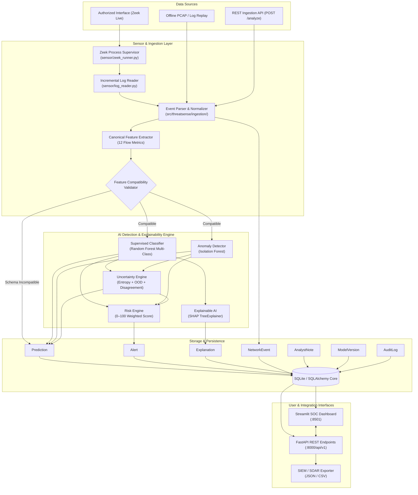

# ThreatSense AI — System Architecture

**Tagline:** *Detect. Explain. Defend.*

ThreatSense AI is an end-to-end, explainable network threat surveillance platform that couples passive network flow inspection with supervised attack classification, unsupervised anomaly detection, distribution-aware uncertainty scoring, and automated SHAP explanations.

---

## 1. High-Level Architecture Diagram

---

## 2. Component Breakdown

### A. Sensor & Ingestion Layer
- **Zeek Runner (`sensor/zeek_runner.py`)**: Manages the Zeek process supervisor on explicitly configured, authorized network interfaces (`-i <interface> -C Log::default_logdir=... LogAscii::use_json=T`). Live monitoring strictly uses argument lists without shell interpolation (`shell=False`) to prevent command execution vulnerabilities.
- **Log Reader (`sensor/log_reader.py`)**: Uses non-blocking incremental seeks to tail active `conn.log` output while preserving byte offset state across log rotation, file truncation, and process restarts.
- **Normalizer (`src/threatsense/ingestion/normalizer.py`)**: Parses timestamps into ISO-8601 UTC datetimes, standardizes protocol representations (TCP, UDP, ICMP), and calculates deterministic SHA-256 event fingerprints to guarantee idempotency and deduplication.

### B. Feature Compatibility Layer (`src/threatsense/features/`)
- Mappable 1:1 between Zeek connection records and benchmark network flow datasets (e.g., CIC-IDS2017).
- Strict contract enforcement: Rejects missing, NaN, infinite, or out-of-boundary values with an explicit `FEATURE_SCHEMA_INCOMPATIBLE` diagnostic, preventing silent data fabrication or corrupted inference.

### C. Multi-Signal Detection Architecture
ThreatSense AI clearly separates four independent analytical dimensions:

1. **Classifier Confidence (0.0 to 1.0):**
   - The statistical softmax / probability estimate produced by the supervised Random Forest for the winning attack category (`BENIGN`, `DoS/DDoS`, `PortScan`, `BruteForce`, `Botnet`).
2. **Anomaly Score & Factor (0.0 to 1.0):**
   - The distance metric produced by the unsupervised Isolation Forest trained on baseline normal flows. Lower raw decision scores translate into higher abnormality factors.
3. **Uncertainty State:**
   - Evaluates Shannon entropy across the class probability vector, checks out-of-distribution (OOD) unfamiliarity, and detects **detector disagreement** (e.g. classifier predicts benign, but isolation forest flags an anomalous flow).
   - States: `CONFIDENT`, `HIGH_UNCERTAINTY`, `OUT_OF_DISTRIBUTION`, `DETECTOR_DISAGREEMENT`, `REVIEW_REQUIRED`.
4. **Operational Risk Score (0 to 100):**
   - A multi-criteria heuristic risk indicator combining attack category baseline severity, classifier confidence, anomaly factor, target port sensitivity (e.g. SSH, RDP, SMB), and uncertainty penalty.
   - **Crucial Distinction:** Operational risk scores represent prioritized triage indicators for SecOps analysts, NOT mathematical probabilities of compromise.

### D. Explainability Engine (`src/threatsense/explainability/`)
- Computes local SHAP (SHapley Additive exPlanations) values via `shap.TreeExplainer` for the predicted class.
- Identifies the top positive and negative features influencing the classifier decision.
- Formats attributions into plain-language analyst summaries while emphasizing that model explanations represent statistical correlation rather than absolute proof of malicious intent.
- Gracefully falls back to surrogate model-feature weightings if tree explainer conditions are unavailable, ensuring inference is never interrupted.

### E. Storage Layer (`src/threatsense/storage/`)
- Relational schema via SQLAlchemy with foreign key constraints, indexes, and auditable triage histories across 7 core entities: `NetworkEvent`, `Prediction`, `Alert`, `Explanation`, `AnalystNote`, `ModelVersion`, and `AuditLog`.

---

## 3. Passive Defense & Ethical Scope

ThreatSense AI operates strictly under a **passive defensive posture**:
- No active packets, resets, or scanning probes are transmitted.
- Live network capture is limited strictly to authorized local interfaces.
- Offline replay mode provides completely deterministic demonstrations without elevated raw capture privileges.
